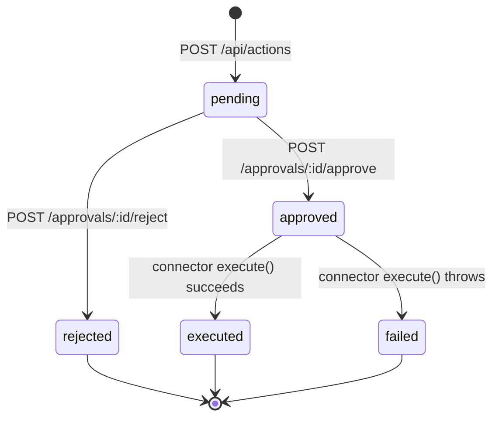

# How it works

The dashboard splits reads from writes. Reads are aggregated and served directly. Writes are never executed on request — they are recorded as proposals and held until a human decides.

## Statuses

| Status     | Meaning                                                     |
| ---------- | ----------------------------------------------------------- |
| `pending`  | Proposed. Nothing has run.                                  |
| `approved` | A human approved it; execution has been attempted.          |
| `rejected` | A human declined it. Terminal — nothing runs.               |
| `executed` | The connector's `execute()` returned successfully.          |
| `failed`   | `execute()` threw. The error is captured in `resultDetail`. |

Only `pending` actions can be decided. A second decision on an already-decided approval returns `404` rather than overwriting the first — decisions are not revisable through the API.

## The lifecycle



## Propose

`POST /api/actions` with `source`, `actionType`, and `summary`. The worker assigns a UUID, sets `status: pending` and `createdAt`, and stores it. Nothing executes.



## Review

`GET /api/approvals` lists proposals newest-first. Each carries its `riskTier` — `standard` or `hard_stop`.



## Decide

`POST /api/approvals/:id/approve` or `.../reject`, optionally with `decidedBy`. The record gains `status`, `decidedAt`, and `decidedBy`.



## Execute

Only on approval. The worker dispatches to the connector's `execute()` and records the outcome as `executed` or `failed`, with detail in `resultDetail`. A rejection never reaches a connector.



## Storage

Approvals live in Workers KV under the `APPROVALS_KV` binding. Each record is stored at `approval:<id>`, with an index at `approvals:index` holding the most recent **200** IDs, newest first.


The index is capped at 200. Older approvals remain readable individually by ID, but drop out of `GET /api/approvals`. If you need durable history beyond that window, export it before the cap rolls over.


## Risk tiers

`riskTier` defaults to `standard` and accepts `hard_stop`. It is metadata for the reviewer — the worker does not treat the two differently. Hard-stop actions are governed by [policy](https://app.gitbook.com/s/CLVU3zDPYq3NtGA5U56K/policies/hard-stop-rules), not by this code path, and should not be wired for automatic execution at all.
