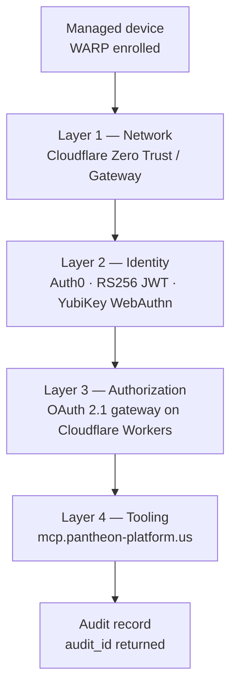

# The four layers

Every MCP tool call travels the same path. Each layer denies by default; passing one layer grants nothing at the next.

## Layer 1 — Network

Cloudflare Zero Trust and Gateway. The WARP client is enrolled on every managed device, and both DNS and HTTP inspection are enforced. Device posture is checked before MCP traffic is permitted at all.


Zero Trust is a prerequisite, not a hardening step. Do not invoke MCP tools from a device that is not WARP-connected with identity-bound enrollment.


## Layer 2 — Identity

Auth0, at `pantheon-platform.us.auth0.com`. Tokens are RS256-signed JWTs carrying custom claims under the `https://pcg.io/` namespace. YubiKey WebAuthn MFA is required to reach AAL2, which in turn is required for PCG and PST scopes.

Roles and `entity_scope` are assigned per principal. Federation grants identity — it does not grant authorization.

| Claim                  | Purpose                                                       |
| ---------------------- | ------------------------------------------------------------- |
| `entity_scope`         | Which entity namespaces the principal may reach               |
| `pcg/roles`            | Role assignments checked against each tool's `required_role`  |
| `pcg/aal`              | Authenticator assurance level, checked against `required_aal` |
| `pcg/document_binding` | Document ID a session is bound to, for binding-required tools |


The MCP server uses RS256. If any integration proposes symmetric (HS256) JWT signing, refuse it and escalate — a shared secret turns every verifier into a signer.


## Layer 3 — OAuth 2.1 gateway

`@cloudflare/workers-oauth-provider`, running on Cloudflare Workers.

* Authorization code + PKCE only. There is no implicit flow, and PKCE is never bypassed.
* The `props` object is encrypted with AES-GCM.
* Tokens are stored as SHA-256 hashes only — never in plaintext.

## Layer 4 — MCP server

`mcp.pantheon-platform.us`. One server hosts all five entity namespaces and denies by default: the JWT's `entity_scope` must cover the tool's prefix or the call is rejected.

Every invocation is audited and rate limits are enforced per scope.


Validate `aud` strictly. A JWT issued for `https://mcp.pantheon-platform.us/api` is not valid for any other resource server, even inside the same Auth0 tenant. Production trusts only `iss = https://pantheon-platform.us.auth0.com/`; staging tokens are rejected.


## Related

* [Tool invocation](../reference/tool-invocation.md) — the preflight checks each call must pass
* [Security rules](https://app.gitbook.com/s/CLVU3zDPYq3NtGA5U56K/policies/security-rules) — the non-negotiable constraints across all four layers
