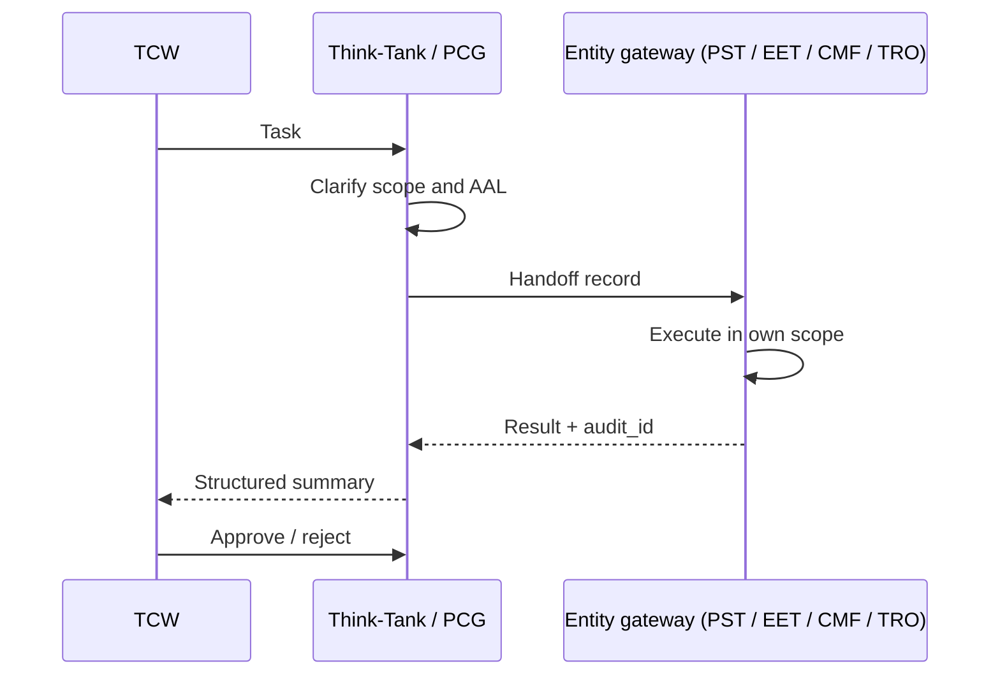

# Handoff chain

PCG is the parent entity. Work starts at PCG scope, decomposes into entity-specific tasks, and returns to PCG — and to TCW — for final approval.



## The handoff record

Delegating to another agent emits a handoff record:

```json
{
  "handoff_from": "think-tank/PCG",
  "handoff_to": "<agent>/<scope>",
  "task_summary": "...",
  "context_document_id": "PCG-...",
  "requires_return": true,
  "approval_pending": "TCW"
}
```


Handoff records are transmitted and stored. Never place access tokens, refresh tokens, client secrets, YubiKey PINs, or PIV key material in one — or in any file, comment, or response.


## The workflow

Every task follows the same five steps.



## Clarify

Identify which entity namespaces the task touches. Confirm the calling principal's scope and AAL before planning anything.



## Plan

Break the task into discrete actions and state them explicitly. Flag any [hard-stop actions](https://app.gitbook.com/s/CLVU3zDPYq3NtGA5U56K/policies/hard-stop-rules) **before** beginning, and obtain TCW's confirmation for each one.



## Execute

Read before writing. Run `npm run check` on code tasks. Validate current state before applying config changes. Invoke APIs sequentially and capture `audit_id` at each step.



## Audit

Emit a structured summary: actions taken, `audit_id` values, outcomes, and Document IDs. Flag partial completions with their error codes and the next step required.



## Human-in-the-loop gate

Present the summary to TCW. No consequential operation is complete until TCW acknowledges it.




When a hard-stop is encountered mid-sequence, halt the **entire** sequence — not just the blocking action. Report what blocked and why, then wait for explicit instruction.

